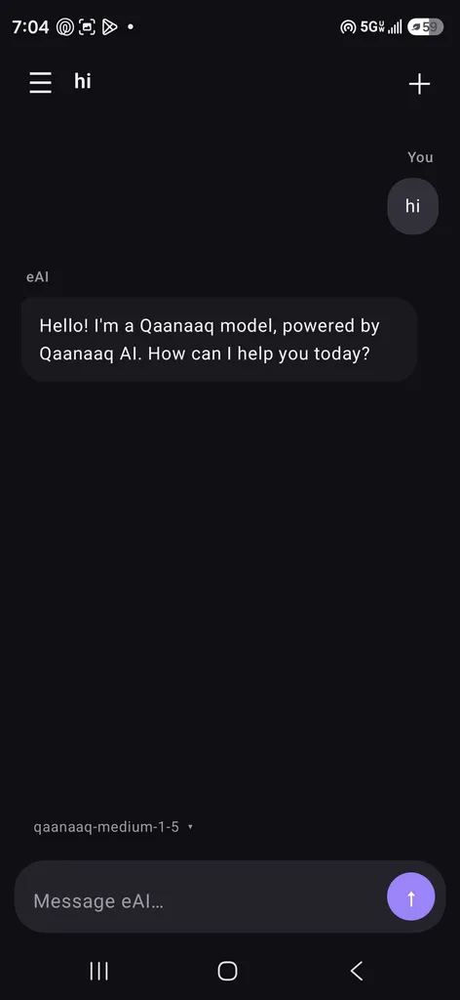
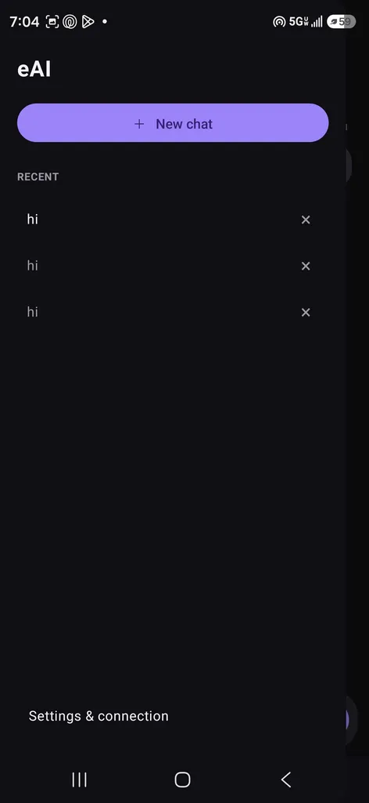
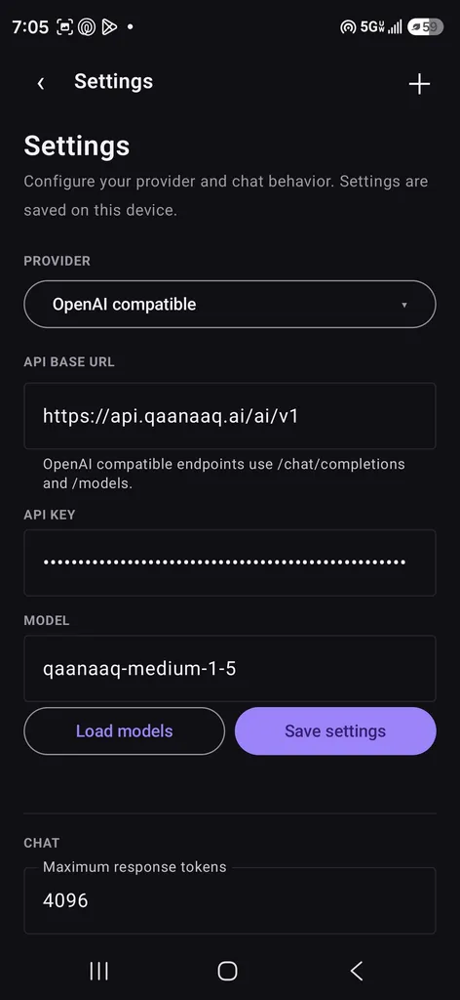

# eAI Mobile for Android

[](#-installation)
[](./LICENSE)

> Android companion app for eAI. Connect to Ollama on your local network, OpenAI-compatible APIs, Anthropic, or Google Gemini.

The Android app is built with **Kotlin** and **Jetpack Compose**. It includes a touch-first chat interface, streaming responses, saved conversations, and persistent provider settings.

---

## 📸 Pictures

### Chat



### Conversation history



### API and model settings



---

## ✨ Features

- **Multiple providers** — connect to Ollama, OpenAI-compatible services, Anthropic, and Google Gemini.
- **Persistent settings** — API keys, base URLs, selected model, system instructions, and generation preferences are saved on the device.
- **Streaming chat** — responses stream into the conversation as they arrive.
- **Conversation history** — create, switch between, and delete saved chats.
- **Touch-friendly interface** — mobile navigation, prompt suggestions, model selection, and a keyboard-aware composer.
- **Private chat storage** — conversation history stays in the app's private device storage.

---

## 🛠 Tech Stack

| Component | Library |
| :--- | :--- |
| UI | [Jetpack Compose](https://developer.android.com/develop/ui/compose) / Material 3 |
| HTTP | [OkHttp](https://square.github.io/okhttp/) |
| Local settings | Android SharedPreferences |
| Conversation storage | App-private JSON files |

---

## 📦 Installation & Setup

### Install the APK

Download the latest debug APK from the repository's build artifacts or build it from source using the steps below. Install the APK on an Android device running Android 8.0 (API 26) or later.

### Connect an API

Open **Settings & connection**, choose a provider, enter its base URL and API key if required, select a model, and tap **Save settings**. The provider configuration is stored on the device so it does not need to be entered each time.

For Ollama, the phone and computer must share a network. Set the URL to the computer's LAN address, such as `http://192.168.1.20:11434`, and configure Ollama on the computer to accept LAN connections.

For OpenAI-compatible APIs, enter the service's API base URL (typically ending in `/v1`), API key, and model ID. Anthropic and Gemini use their respective API base URLs and keys.

### Build from Source

Open the `Mobile` directory in Android Studio and sync Gradle, or run:

```bash
gradle assembleDebug
```

The APK is generated at `app/build/outputs/apk/debug/app-debug.apk`.

---

## 🔒 Privacy

API keys and settings are stored in app-private preferences. Conversations are stored in app-private device storage. Requests are sent directly to the provider URL configured in Settings. The app uses cleartext HTTP for local Ollama connections; use a trusted network or an HTTPS endpoint for remote services.

## 📄 License

This project is available under the [MIT License](./LICENSE).
